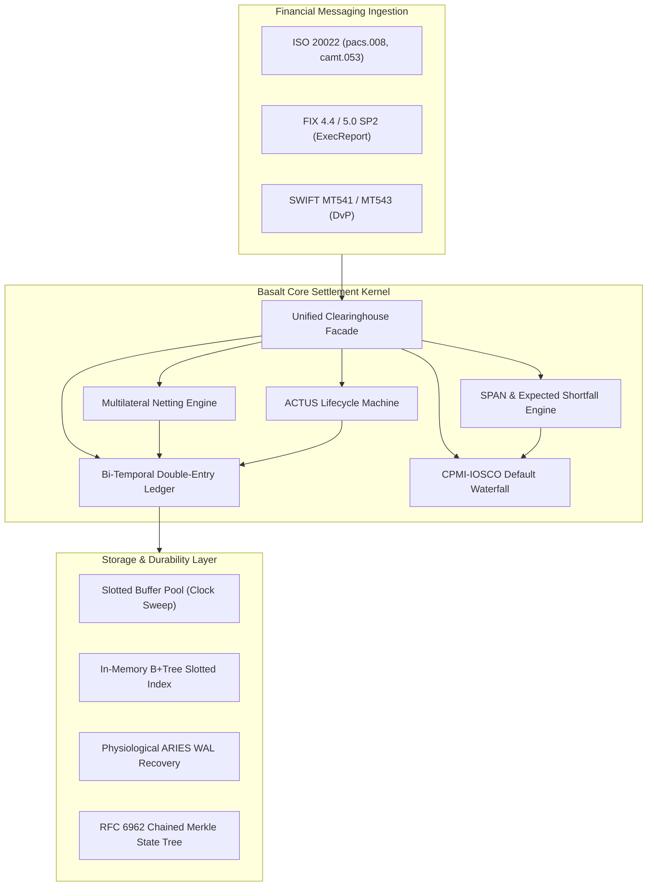
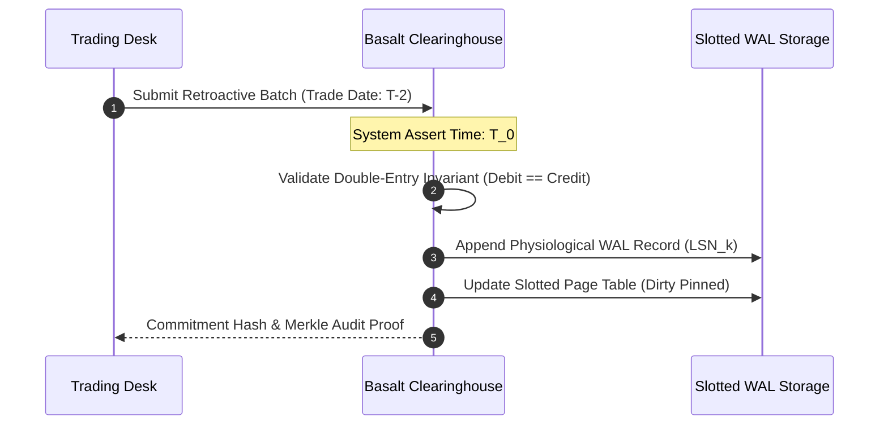
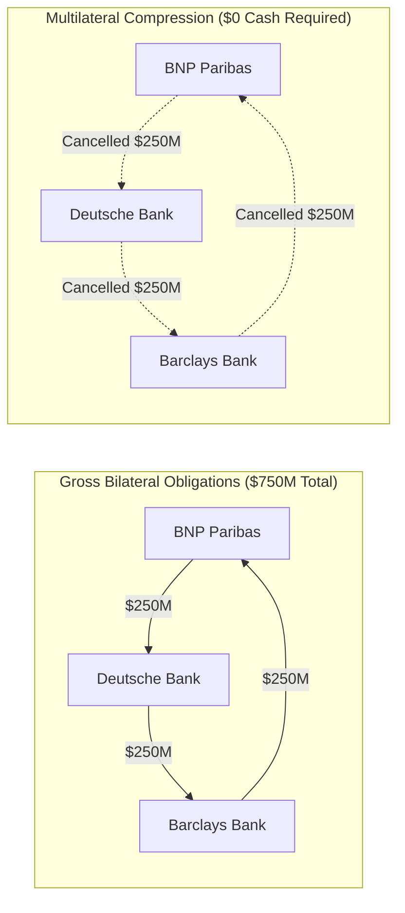
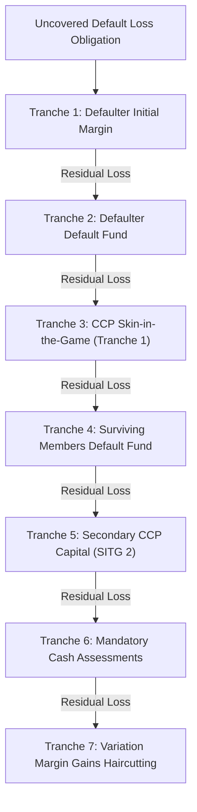
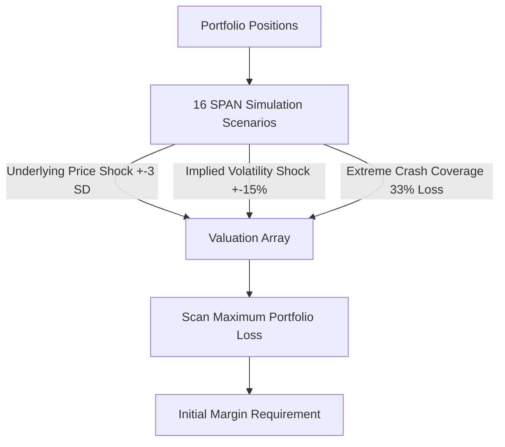
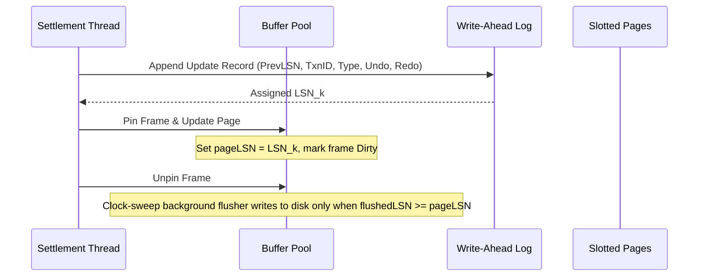

# Basalt Architecture Specification

Basalt is a deterministic bi-temporal clearinghouse and central counterparty settlement kernel implemented in pure COBOL. The system combines graph-theoretic multilateral obligation compression, bi-temporal double-entry bookkeeping, multi-asset portfolio risk margining, slotted page storage, physiological crash recovery, and cryptographic audit proofs into an integrated settlement engine.

---

## 1. Bi-Temporal Double-Entry Ledger

Financial settlement ledgers must distinguish between two orthogonal time dimensions:

1. **Valid Time (Economic Time)**: The actual date on which an obligation, trade, or cash transfer legally occurs.
2. **Transaction Time (System Time)**: The physical wall-clock timestamp at which the clearinghouse asserts, records, and commits the state into immutable storage.

### Bi-Temporal Query Algebra

Basalt supports two primary temporal query operations:

* **AS-OF Query (Valid-Time)**: Computes the reconstructed account balance at any point along the economic timeline. Retroactive adjustments take effect at their valid date without altering system timestamps.
* **AS-AT Query (System-Time)**: Reconstructs the exact state of the ledger as known to the clearinghouse at system time $T_{sys}$. This enables reproducible regulatory audits and post-event forensics.

### Double-Entry Conservation Invariant

Every journal transaction consists of at least two balanced posting entries:

$$\sum_{i=1}^{n} \text{debit}_i = \sum_{j=1}^{m} \text{credit}_j$$

Across all participant accounts, total system cash is strictly conserved under closed-system operations:

$$\sum_{a \in \mathcal{A}} \text{settled\_balance}(a) = \text{Constant}$$

---

## 2. Multilateral Netting and Cycle Cancellation

Direct bilateral gross settlement requires vast liquidity pools. In an interbank network with $N$ participants, gross bilateral exposures scale as $\mathcal{O}(N^2)$. Basalt models interbank debt obligations as a directed graph $G = (V, E)$, where:

* Vertices $V$ represent clearing participants (identified by SWIFT BIC11 codes).
* Directed edges $(u, v) \in E$ represent bilateral net payment obligations from participant $u$ to participant $v$ with capacity $c(u, v) > 0$.

### Algorithm Pipeline

1. **Cycle Detection**: The engine computes Strongly Connected Components (SCCs) using Tarjan's algorithm, followed by Johnson's elementary cycle-finding traversal.
2. **Cycle Cancellation**: For each simple directed cycle $C = (v_1, v_2, \dots, v_k, v_1)$, the bottleneck flow is identified:
   $$\delta = \min_{e \in C} c(e)$$
   The capacity of each directed edge along the cycle is reduced by $\delta$:
   $$\forall e \in C, \quad c(e) \leftarrow c(e) - \delta$$
   Edges with $c(e) = 0$ are pruned from the network.
3. **Gridlock Resolution**: Residual unbalanced flows subject to participant intraday liquidity caps and credit limits are resolved using a Push-Relabel maximum preflow algorithm with height function relabeling.

---

## 3. CPMI-IOSCO Default Waterfall Engine

To protect against systemic contagion when a clearing participant experiences insolvency, Basalt implements the standard 7-tranche CPMI-IOSCO loss mutualization waterfall:

### Waterfall Tranche Ordering

1. **Defaulter Initial Margin**: Collateral posted specifically by the defaulting member is liquidated first.
2. **Defaulter Default Fund**: The defaulting member's contribution to the clearinghouse guaranty pool is applied second.
3. **CCP Skin-in-the-Game (SITG Tranche 1)**: Dedicated equity capital provided by the CCP ($100,000,000.00 USD) is absorbed before mutualizing losses across surviving peers.
4. **Non-Defaulting Members Default Fund**: Mutualized guaranty fund contributions from surviving participants are applied pro-rata based on clearing volume.
5. **Secondary CCP Capital (SITG Tranche 2)**: Additional CCP reserves ($50,000,000.00 USD).
6. **Cash Assessment Calls**: Statutory assessment powers levied against non-defaulting clearing participants up to their contractual assessment limits.
7. **Variation Margin Gains Haircutting (VMGH)**: Reductions in variation margin gains payable to winning participants, preventing CCP insolvency under extreme market shocks.

---

## 4. Portfolio Risk and SPAN Margining

Basalt enforces 128-bit fixed decimal arithmetic (`PIC S9(18)V9(8) COMP-3`) across all risk modeling, eliminating IEEE-754 floating-point drift.

### SPAN 16-Scenario Grid

The risk engine shocks portfolios across 16 canonical volatility-price nodes:

1. Price unchanged, Volatility unchanged.
2. Price unchanged, Volatility up.
3. Price unchanged, Volatility down.
4. Price up 1/3 scan range, Volatility up.
5. Price up 1/3 scan range, Volatility down.
6. Price down 1/3 scan range, Volatility up.
7. Price down 1/3 scan range, Volatility down.
8. Price up 2/3 scan range, Volatility up.
9. Price up 2/3 scan range, Volatility down.
10. Price down 2/3 scan range, Volatility up.
11. Price down 2/3 scan range, Volatility down.
12. Price up full scan range, Volatility up.
13. Price up full scan range, Volatility down.
14. Price down full scan range, Volatility up.
15. Price down full scan range, Volatility down.
16. Extreme downside crash (double scan range, 33% loss weighting).

### Historical Simulation VaR and Expected Shortfall

$$\text{VaR}_\alpha(X) = \inf \{ l \in \mathbb{R} : P(L > l) \le 1 - \alpha \}$$

$$\text{ES}_\alpha(X) = \mathbb{E}[L \mid L \ge \text{VaR}_\alpha(X)]$$

---

## 5. Storage, Buffer Pool, and ARIES Crash Recovery

Basalt manages an in-memory 4096-byte slotted page buffer pool with a clock-sweep second-chance frame replacement algorithm.

### ARIES Three-Pass Recovery Protocol

Upon system restart following an ungraceful shutdown:

1. **Analysis Pass**: Reads the WAL forward from the latest checkpoint start record. Reconstructs the active Transaction Table (TT) and Dirty Page Table (DPT) with initial `recLSN` values. Identifies loser transactions that were active at crash time.
2. **Redo Pass**: Scans forward from the minimum `recLSN` found in the DPT. Repeats history by reapplying all logged updates (both committed and uncommitted transactions) to pages whose `pageLSN < logLSN`.
3. **Undo Pass**: Scans backward through active loser transactions using `prevLSN` pointers. Reverses logged operations and writes Compensation Log Records (CLRs) with `undoNextLSN` pointers. Recovery is completely idempotent against crashes during the recovery phase itself.

---

## 6. Cryptographic State Tree and Merkle Audit Trail

Basalt constructs an RFC 6962 compliant binary Merkle tree over every settlement batch:

$$\text{Leaf Node} = \text{SHA256}(0\text{x}00 \mathbin{\Vert} \text{Payload})$$
$$\text{Internal Node} = \text{SHA256}(0\text{x}01 \mathbin{\Vert} \text{LeftChild} \mathbin{\Vert} \text{RightChild})$$

The root commitment digest provides cryptographic proof of ledger state integrity, enabling third-party audit verification with $\mathcal{O}(\log N)$ proof complexity.
